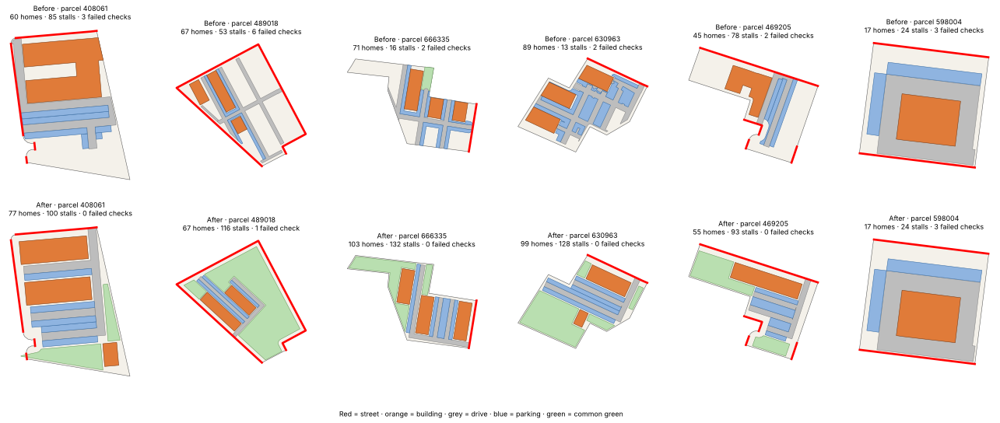

# Apartment plans drawn to the layout rules (g59, 2026-11-27)

Owner: "we shouldn't have random parking lots not touching the building or another lot" and "Go" (make the generators design to the rules, not be checked afterwards).

## Correction to g58 first

The g58 gate read its rule list from `training.ai_config` as the caller. Anonymous visitors cannot read that table, so on the live site the gate silently did nothing: an anonymous call on 1710 Meharry (parcel 488278) still returned the 30-home plan after g58 was reported live. The rule list now comes through `fn_mf_layout_rules()` and the anonymous call returns the new plan (checked through the public API with the app's own key).

## What changed

`fn_generate_mf_frontage_plan` (generator `mf_frontage_v2`) is a deterministic drafter. No model makes a decision in it; it is not AI.

- A building bar on a street at the front setback.
- Parking only behind the building line, or beside the building on lots too shallow for that. Every stall row sits against a building or the next row.
- One driveway down a side lot line. Nothing paved between a building and its street.
- Double-loaded aisles wherever the depth allows.
- Deeper sites alternate bar / parking / bar. Every street run is tried as the front.
- Leftover land at least 20 ft wide becomes common green.
- All program numbers (stall and aisle size, bar depth, stories, unit sizes, density, coverage, impervious cap, parking ratio) come from the planner solver brief. Drafter settings are in `training.ai_config` `mf_frontage_drafter`, each with its source.

`fn_generate_mf_site_plan_v2` is now a thin wrapper. It runs the engine as before (renamed `fn_generate_mf_site_plan_v2_engine`), then the drafter. The drafter's plan is the default when it has at least as many homes, breaks no more layout rules, and has more homes or fewer failed checks. `mf.frontage_gate = 'off'` returns the engine plan.

Homes are compared on one basis: what the plan's own floor area and stalls carry at the code parking ratio (`fn_mf_plan_parked_program`). Engine plans often report homes their stalls cannot park (parcel 630963: 89 homes on 13 stalls). Inside the Urban Zoning Overlay, where there is no parking minimum, the engine's reported homes are used when they are higher.

## Measured, gate off vs on

| | 33 parcels used while building | | 35 fresh parcels | |
|---|---|---|---|---|
| | Off | On | Off | On |
| Plans replaced | | 18 | | 11 |
| Homes shown | 1,283 | 1,442 | 1,741 | 1,776 |
| Homes the stalls carry | 1,005 | 1,439 | 875 | 1,115 |
| Stalls | 1,418 | 2,037 | 2,023 | 2,346 |
| Floor area (sf) | 1,747,476 | 1,696,637 | 2,856,505 | 2,761,680 |
| Failed checks | 82 | 41 | 88 | 67 |
| Layout-rule breaks | 22 | 9 | 20 | 14 |
| Plans with no failed check | 1 | 14 | 1 | 8 |
| Average time | 1.3 s | 2.3 s | 0.8 s | 1.5 s |
| Longest | | 6.1 s | | 4.2 s |

No parcel lost homes or gained a failed check in either set. The fresh set is 40 built-apartment parcels (0.3 to 6 acres) drawn at random from `training.built_mf_site`, none used while building; 35 of them produce a plan.

## What is still wrong

- **Smaller homes.** The drafter takes the most homes its stalls carry, which pushes the average home toward the 750 sf floor of the brief's band. Floor area is 3% lower in both sets. Owner decision pending: hold the average at the market mix (960 sf) instead.
- **23 rule breaks remain on 68 parcels.** Where the engine plan carries more homes than the drafter's, the engine plan stays even if it breaks a rule (parcel 598004, last column of the drawing).
- **Urban Zoning Overlay.** The drafter still caps homes by stalls there, so it under-draws those sites.
- **Corner lots.** The driveway can land between the bar and the side street (632606). An L-shaped building on both streets is not drawn.
- **Dead-end aisles over 150 ft** are flagged for review, not looped.
- **No structured parking**, no curved or angled frontages, no shared access.
- **Time.** About one second slower on average.
- `ml/review/score.py` still lacks the three layout rules.
