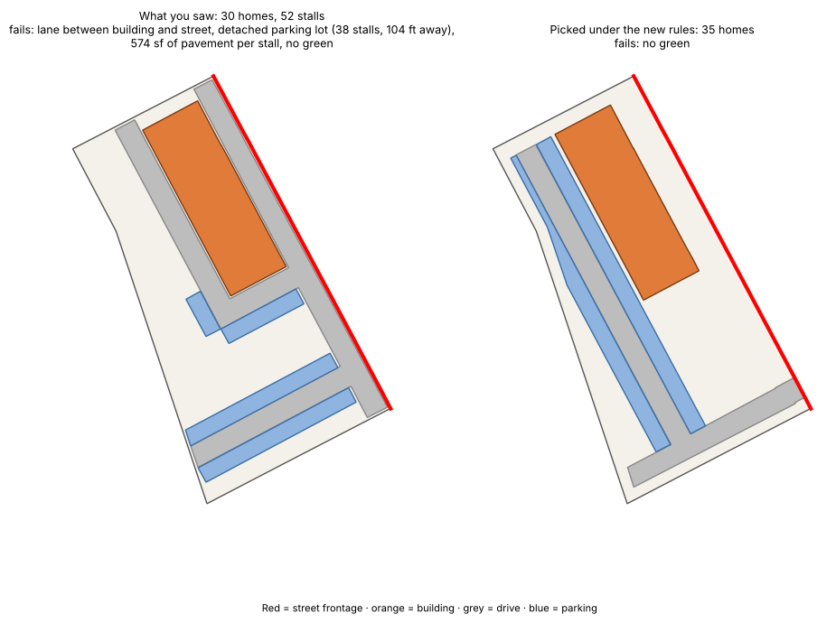

# Apartment layout rules: parking must touch something (g58, 2026-11-27)

Owner audit of 1710 Meharry Blvd (parcel 488278, RM20, 1.76 ac): "we shouldn't have random parking lots not touching the building or another lot."

## What the plan on screen measured

- A 26-ft lane ran the full 404 ft of frontage between the building and the street: 82% of that ground was paved.
- 38 of 52 stalls sat in a lot 104 ft from the building and 60 ft from the nearest lot that touched it.
- 574 sf of drive and parking per stall, against the 420 sf planning figure.
- 43.6% of the site unused, no green, 30 homes where 35 fit.
- The existing checks passed everything except green.

## Three rules added to `fn_mf_design_checks`

Thresholds are in `training.ai_config` key `mf_design_check_thresholds`, each with its source.

| Check | Rule | Threshold |
|---|---|---|
| `parking_attached` | Every parking lot is within one aisle of a building, or of a lot that is | `attach_gap_ft` 32 |
| `no_pavement_in_front` | Share of the ground between a building and its street that is paved | `front_pavement_share` 0.25 |
| `pavement_per_stall` | Drive + parking area per stall vs `fn_max_buildout` stall_land_sf (surface parking only) | `pavement_per_stall_factor` 1.25 |

## Seed plan gate in `fn_generate_mf_site_plan_v2`

A seed plan that breaks a rule listed in `ai_config` `mf_seed_layout_rules` gives way to the search plan when the search plan keeps at least as many homes and breaks fewer of those rules. Flag: `seed_plan_replaced_layout_rules_v1`. `mf.seed_rules = 'off'` restores the old behaviour.

## Measured, 33 parcels, rules off vs on

| | Off | On |
|---|---|---|
| Homes | 1,256 | 1,283 |
| Failed checks | 89 | 82 |
| Average time | 0.86 s | 1.26 s (max 4.3 s) |

17 of 33 were seed plans; 6 were replaced. No parcel lost homes or gained fails.

Rule fails that remain with the gate on: pavement in front 11, pavement per stall 10, detached lot 1. On those parcels the search plan breaks the rule too, so the gate has nothing better to swap in. The generators themselves do not yet design to these rules.

## 1710 Meharry after

35 homes, one driveway, one double-loaded aisle behind the building, nothing paved between building and street. Only failing check: usable green (leftover land is not programmed). The plan came from the engine's search, not the design model: the model proposed 3 to 8 small buildings there and the engine drew one. It is labelled `engine_alternative`.

## Not done

- `ml/review/score.py` does not have the three rules.
- Generators do not obey the rules while drawing; they are only checked afterwards.
- Leftover land is not turned into green.
