# Cohort run 3 on engine g17 · 2026-11-10

Eric: "Try it again." The engine changed after the g16 handoff (the crash on
8192 Charlotte Pike is gone, `best_requested` is back, shared drives are the
default on ten parcels), so all 70 parcels were harvested, scored and read
again. The engine handoff for this run is [ENGINE_HANDOFF.md](ENGINE_HANDOFF.md).
The previous run is `qa/audits/2026-11-10/`.

## The number

| | g15 | g16 | g17 |
|---|---|---|---|
| Plans where a civil would draw one | 18 of 40 | 19 of 40 | **24 of 40** |
| Refusals where nothing belongs | 25 of 30 | 26 of 30 | **26 of 30** |
| Mean likelihood, 40 plans | | 42.2 | **48.0** |
| Mean likelihood, 30 refusals | | 68.8 | **69.8** |
| Plans at 60 or better | | 10 of 40 | **15 of 40** |

Five parcels fixed (3345 Pugh Rd, 7695 Old Charlotte Pike, 0 Neelys Bend Rd,
0 Clovernook Dr, 8192 Charlotte Pike), none broken. Of the 21 sheets that
changed, 14 read better, 4 worse and 3 the same.

The g16 likelihood figures are restated. 0 Longwood Pl was read at 70 in the
last run; 3.89 of its 4.41 ac are other owners' lots inside the outline and
the plan cannot be built, so it is 15 in both runs. That was a misread, not
an engine change, and it is taken out of the comparison (the last write-up
gave 43.6 and 11 of 40).

## How it was read

The same method as the last run: live answers harvested through SQL, scored
with `scripts/engine-cohort/score.mjs` against the g16 run, the 26 parcels
whose plan or competition changed driven through the app on a local build,
each changed sheet read as a plan. A parcel whose sheet did not change
keeps its figure. The likelihood is one reader's judgment. The sandbox
cannot reach the deployed app.

No migration is recorded for this engine release; "g17" is this
repository's name for what was live on 2026-11-10 after the g16 handoff.

## The ranking

A likelihood shown as "a → **b**" changed in this run.

### Plans (40): something should be drawn

| # | Parcel | On the sheet now | Cohort | Likelihood | Read |
|---|---|---|---|---|---|
| 1 | 0 Hillwood Blvd · RS40 · 2.85 ac (679618) | 3 estate lots | pass | 85 | Right. |
| 2 | 0 Old Hydes Ferry Pike · RS20 · 1.37 ac (679683) | 2 estate lots | pass | 75 | A front lot and a flag lot. |
| 3 | 1014 Antioch Pike · R8 · 2.8 ac (667638) | 8 lots on a cul-de-sac | pass | 75 | One more lot than g15; pie lots round the bulb. |
| 4 | 0 Clovernook Dr · RS10 · 1.17 ac (673567) | 3 frontage lots (1 flag) | **pass (was miss)** | 50 → **70** | FIXED. Two front lots and a flag lot behind, as the target said. |
| 5 | 0 Hills Ln · R10 · 6.62 ac (680391) | 17 lots on one street | pass | 70 | A straight street with 70 x 145 lots both sides. (The sheet showed the 14-lot default until the app stopped depending on best_requested.) |
| 6 | 6247 Mt View Rd · RS10 · 6.9 ac (666092) | 15 lots on a T street | pass | 55 → **70** | The T is back, with three connections and no fails; the single street that failed grade is replaced. |
| 7 | 0 Nashboro Blvd · R10 · 3.46 ac (672524) | 10 frontage lots (3 flag) | pass | 70 → **65** | Two more lots from lotting the remainder; three are flag lots with poles between neighbours. |
| 8 | 0 Neelys Bend Rd · RS40 · 18.91 ac (679830) | 4 lots on a shared drive | **pass (was miss)** | 50 → **65** | FIXED. Four lots on the bench at the end of a 1,637-ft lane up the panhandle (was two). |
| 9 | 3345 Pugh Rd · RS80 · 28.14 ac (380818) | 9 lots on a shared drive | **pass (was miss)** | 15 → **65** | FIXED. Nine 2-ac lots either side of a 1,743-ft private lane up the middle of the strip (was 3 houses at the mouth). The north 5 ac past the turnaround is unassigned, and the lane is over the engine's own 750-ft flag. |
| 10 | 0 Hickory Hollow Pkwy · RM20 · 1.95 ac (673710) | 29 townhomes on a mews | pass | 60 | Four rows on a drive loop. |
| 11 | 0 Homeland Dr · RS40 · 9.02 ac (674961) | 5 lots on a shared drive | pass | 35 → **60** | Back to a shared drive: 834 ft, one connection (was 1,378 ft of public street with three). Lot 5 is 38,416 SF on RS40 land; lot 4 is mostly wetland buffer. |
| 12 | 0 Ridgewood Rd · RS80 · 6.33 ac (680408) | 0 lots, landlocked | pass | 60 | Acceptable here. |
| 13 | 4525 Cato Rd · RS15 · 2.14 ac (661303) | 2 lots on a shared drive | pass | 60 → **60** | A private drive now, still through the wetland buffer and still ending in a full turnaround for two houses. |
| 14 | 605 Harpeth Ln · RS40 · 5.18 ac (660683) | 2 lots on a shared drive | pass | 70 → **60** | The default is still one house; the sheet takes the competition's two lots on a 760-ft lane that crosses 549 ft of held hillside. One house was the cleaner answer. |
| 15 | 6404 Eatons Creek Rd · R40 · 9.02 ac (661661) | 5 estate lots (2 flag) | pass | 60 | Three frontage lots and two 2.8-ac flag lots on poles. Plausible. |
| 16 | 0 Stewarts Ferry Pike · RS15 · 3.3 ac (679617) | 4 lots on a shared drive | pass | 50 → **55** | A private drive in place of the public street and bulb, as the target said; the fourth lot is still a 53,092-SF tail. |
| 17 | 0 Swiss Ave · RM15 · 4.1 ac (679911) | 36 townhomes on a street | pass | 55 | The multifamily plan (60 units) fails the app's geometry gate (a building overlaps a drive), so the townhomes are the sheet. |
| 18 | 0 Westcap Rd · R15 · 10.6 ac (679820) | 6 frontage lots | miss | 55 | Improved: was 8 lots on a street at 27%. Six clean lots off Westcap Rd, hillside held; two of the six are double-size. |
| 19 | 7695 Old Charlotte Pike · R80 · 45.9 ac (692464) | 9 lots on a shared drive | **pass (was miss)** | 35 → **55** | FIXED. The same bench layout on a private lane, not a public street. 2,810 ft long, 1,535 ft of it in wetland buffer, one station at 16.5%. |
| 20 | 0 Hart Ln · R10 · 35.0 ac (680596) | 50 lots on terraces | miss | 45 → **50** | The passing terrace plan is now the default (was the 76-lot loop at 23.4%). Five short of the range: 43% of the site is unassigned and four lots are just under 10,000 SF. |
| 21 | 0 Poplar Creek Rd · RS15 · 2.5 ac (677645) | 4 lots on a shared drive | pass | 40 → **50** | A private drive, as the target said. One lot is 14,530 SF on RS15 land and the turnaround is as large as a lot. |
| 22 | 8192 Charlotte Pike · R40 · 31.63 ac (668277) | 1 lot at the road | **pass (was miss)** | 0 → **50** | FIXED: no error. One house on the frontage with the hillside held; the 6-lot street is withdrawn. A lane along the creek for 3-6 is still the better plan. |
| 23 | 0 Hessey Rd · RS10 · 5.8 ac (679226) | 9 lots on a shared drive | miss | 40 → **45** | One more lot, on a private lane. Two lots are under 10,000 SF and four are 22,000-36,000; a civil evens them out for 10-12 on a public court. |
| 24 | 0 Old Hickory Blvd · R15 · 5.51 ac (679273) | 1 lot, the parcel | miss | 45 | 68% over 25%; one house with a 323-ft driveway. The target (3-9) is optimistic for this strip. |
| 25 | 0 Walker Ln · RS20 · 5.5 ac (676829) | 4 lots on a shared drive | miss | 25 → **45** | Four lots round a turnaround on a 636-ft lane (was 3 on 955 ft of failing street). One lot is 19,738 SF on RS20 land and one is a 71,265-SF remainder; 5-7 fit. |
| 26 | 0 Campbell Rd · RS80 · 17.8 ac (680202) | 1 lot, the parcel | miss | 40 | 66% over 25%; one house with a 1,211-ft driveway. Two to four on a shared drive is the target. |
| 27 | 7963 Charlotte Pike · R40 · 16.95 ac (667802) | 0 lots, landlocked | miss | 40 | Both the plan and fn_parcel_frontage say landlocked; on 11-04 the engine drew 12 frontage lots. One of the two is wrong: see the handoff. |
| 28 | 0 Carothers Rd · RM9 · 4.73 ac (673509) | 42 apartments | miss | 35 | The bays hold 206 stalls where the summary says 63; townhomes at 36-42 is the product. |
| 29 | 0 Newsom Station Rd · R80 · 27.25 ac (675128) | 4 estate lots | miss | 35 → **35** | Same sheet; the default is now the passing estate lots, not the failing street. Still four equal 6.8-ac lots. |
| 30 | 0 Old Hickory Blvd · RS20 · 5.27 ac (673844) | 2 lots (grid) | pass | 40 → **35** | A public street and bulb across the flood hold for two houses. |
| 31 | 0 Union Hill Rd · RS40 · 7.6 ac (680001) | 4 lots (grid) | pass | 35 | A 644-ft L street from a 46-ft frontage to four RS40 lots; a shared drive does this. |
| 32 | 8282 Charlotte Pike · R40 · 11.87 ac (659670) | 3 estate lots | miss | 35 | Two front lots and a 10-ac flag lot whose house sits at the far end of a 1,900-ft pole through held hillside. |
| 33 | 0 Brittany Park Dr · RS20 · 29.0 ac (678964) | 13 frontage lots | miss | 15 → **30** | The failing loop is withdrawn, honestly. What is left is frontage lots and five remainders of 1.3-6.2 ac across 29 ac that take 28-45. |
| 34 | 3905 Lunn Dr · RS15 · 2.11 ac (680860) | 3 lots on a 365-ft street | pass | 30 | A public street along the north line to a bulb, 23.6% of a 2-ac site in right-of-way; two house footprints touch. Two or three flag lots off Lunn Dr is the civil answer. |
| 35 | 0 Nashboro Blvd · RM6 · 1.66 ac (670783) | 9 apartments | miss | 25 | Ninety-nine stalls for nine units. |
| 36 | 0 Cedarstone Way · RM9 · 3.37 ac (676422) | 30 apartments | miss | 20 | 110 stalls for 30 units on a 17.6% slope. The by-right side now calls the parcel landlocked; fn_parcel_frontage says it is not. |
| 37 | 0 Smith Springs Rd · RM6 · 7.0 ac (670533) | 42 apartments | miss | 20 | One bar with 106-113 stalls for 42 units on RM6 land; townhomes at the cap is the product. |
| 38 | 0 Longwood Pl · R20 · 4.41 ac (681024) | 10 lots on a cul-de-sac (cannot be built) | pass | 15 → **15** | No engine change. Corrected read: 3.89 of the 4.41 ac are other owners' lots inside the outline (a co-op common area); all ten lots sit on them. The chip now says so. |
| 39 | 1019 Hitt Ln · R20 · 21.61 ac (659655) | 1 lot, the parcel | miss | 15 | 21.7 ac drawn as one lot with a 3,716-ft driveway; the 10-ac western block takes a street. |
| 40 | 1716 Red Jacket Dr · R10 · 38.68 ac (681357) | 9 frontage lots (cannot be built) | miss | 10 → **5** | The failing loops are withdrawn. Nine lots on 38.7 ac, seven of them on other owners' land: the outline has 49 holes. The chip now says so. |

### Refusals (30): nothing new belongs

| # | Parcel | On the sheet now | Cohort | Likelihood | Read |
|---|---|---|---|---|---|
| 1 | 0 Newsom Station Rd · R40 · 19.67 ac (677706) | skipped: floodplain | pass | 95 | Right. |
| 2 | 0 Temple Rd · RS40 · 2.78 ac (677010) | skipped: floodplain | pass | 95 | Nothing, with the reason and the hold drawn. |
| 3 | 0 Couchville Pike · RS80 · 1.43 ac (676960) | 0 lots | pass | 90 | Smaller than one RS80 lot; said so. |
| 4 | 0 Penn Meade Way · RS10 · 6.6 ac (677281) | skipped: floodplain and landlocked | pass | 90 | Right. |
| 5 | 0 River Landing Way · R15 · 15.39 ac (676430) | skipped: floodplain | pass | 90 | Nothing; the fill scenario stays an override. |
| 6 | 4819 Fairmeade Ct · RS40 · 1.25 ac (661591) | 1 lot | pass | 90 | Right. |
| 7 | 6211 Brownlee Dr · RS40 · 1.2 ac (424990) | 1 lot, the parcel | pass | 90 | Right. |
| 8 | 6438 Old Clarksville Pike · RS40 · 1.4 ac (667565) | 1 lot, the parcel | pass | 90 | One house on the lot of record. |
| 9 | 0 Drakes Branch Rd · RS40 · 12.22 ac (677593) | 0 lots, landlocked | pass | 85 | Right. |
| 10 | 3730 Homeland Dr · RS40 · 1.6 ac (667183) | 1 lot, the parcel | pass | 85 | Right; the hillside is held. |
| 11 | 5014 Buena Vista Pike · RS15 · 1.1 ac (661271) | skipped: floodplain | pass | 85 | Right. |
| 12 | 54 Park Crescent Cir · R15 · 1.52 ac (659921) | 1 lot, the parcel | pass | 85 | Now one house with a 31-ft driveway (was "no lot fits"): the better answer. |
| 13 | 0 Blevins Rd · RS20 · 31.8 ac (670893) | 0 lots, landlocked | pass | 80 | Right. |
| 14 | 0 Larkin Springs Rd · RS10 · 23.0 ac (680721) | skipped: floodplain | pass | 80 | Right. |
| 15 | 0 Old Hickory Blvd · R40 · 3.21 ac (673175) | 0 lots, landlocked | pass | 80 | FIXED: was 2 lots on a street with access.landlocked failing. |
| 16 | 1422 Campbell Rd · R20 · 17.3 ac (665951) | 0 lots, landlocked | pass | 80 | Right. |
| 17 | 4255 Brick Church Pike · R20 · 4.09 ac (686430) | 1 lot | pass | 80 | Right. |
| 18 | 70 Hillenglade Dr · RS20 · 5.77 ac (661326) | 0 lots, landlocked | pass | 80 | Right. |
| 19 | 810 Due West Ave N · RS20 · 1.48 ac (666615) | 1 lot | pass | 75 | Right. |
| 20 | 0 Gulch St · RS7.5 · 2.4 ac (680528) | skipped: floodplain | pass | 70 | Right. |
| 21 | 0 Robinson Rd · R10 · 31.0 ac (680785) | skipped: floodplain | pass | 70 | Right. |
| 22 | 0 Abbott Martin Rd · R20 · 10.76 ac (681029) | 1 estate lot | pass | 60 | A house on a co-op common area: the engine cannot know the ownership. |
| 23 | 0 Hickory Bend Dr · RS10 · 5.3 ac (672526) | skipped: floodplain | pass | 60 | Right; Zone A with no BFE needs a study. |
| 24 | 415 Eagle Rdg · R15 · 2.9 ac (692658) | 0 lots, "landlocked" | pass | 60 | Right count, wrong reason: fn_parcel_frontage says it has frontage; one house on a hillside is the answer. |
| 25 | 1430 Neelys Bend Rd · RS80 · 8.4 ac (395417) | 0 lots | pass | 50 | Right; 1.25 buildable ac under the RS80 lot. |
| 26 | 0 Dry Fork Rd · RS40 · 31.0 ac (679540) | 2 frontage lots | miss | 5 → **35** | The loop at 59% is gone. Two houses, one of them mid-mountain at the end of a pole straight up the held hillside; one house at the road is the answer. |
| 27 | 0 Old Lebanon Dirt Rd · RM9 · 4.9 ac (679195) | 38 apartments (multifamily) | miss | 30 | Landlocked: the by-right side refuses, the multifamily run still draws an L bar and 68 stalls. |
| 28 | 0 Hicks Rd · RM4 · 4.07 ac (673974) | 14 apartments (multifamily) | miss | 20 | Landlocked and 28% slope; the multifamily run draws. |
| 29 | 0 Todd Preis Dr · RM9 · 10.45 ac (675099) | 94 apartments, flagged a what-if | pass | 10 | The engine still draws 94 units on 9.9 ac of flood hazard area; only the app holds it out as a what-if. |
| 30 | 0 Hickory Hollow Pkwy · RM20 · 1.7 ac (678148) | 9 apartments (multifamily) | miss | 5 | A 54-ft landlocked strip; the bar is drawn across neighbours' buildings. |

## The sheets

The lane rule:

| | |
|---|---|
| 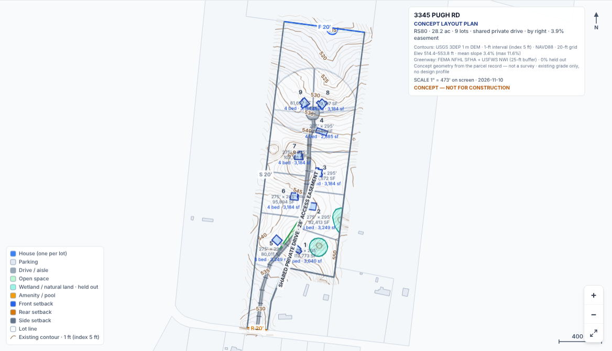 3345 Pugh Rd: nine 2-ac lots on a private lane (was three houses at the mouth) | 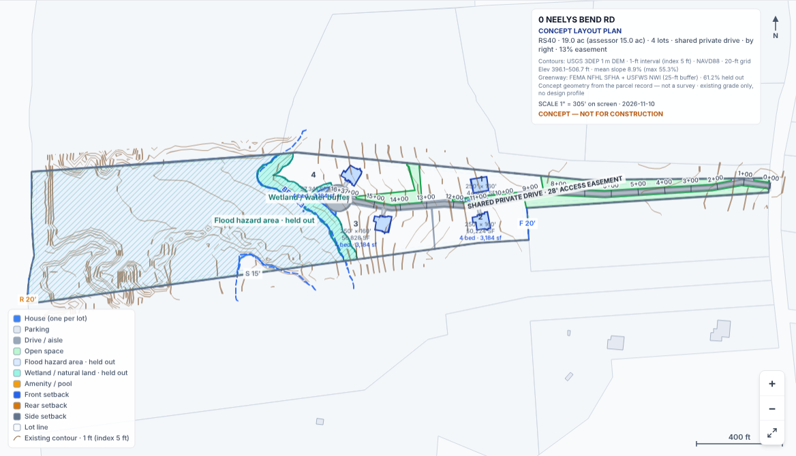 0 Neelys Bend Rd: four lots on the bench at the end of the panhandle |
| 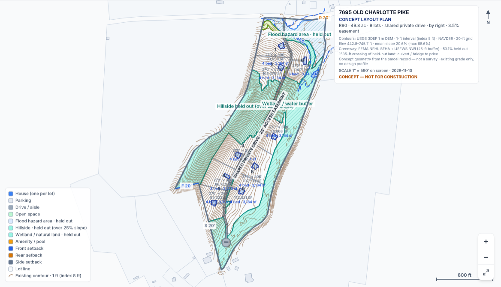 7695 Old Charlotte Pike: the bench layout on a lane, not a public street | 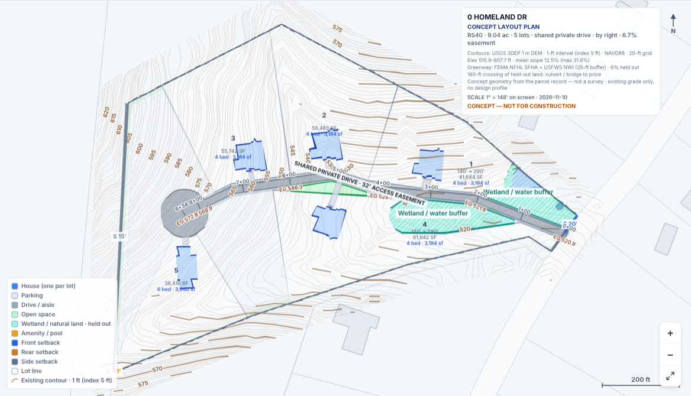 0 Homeland Dr: 834 ft of lane where there was 1,378 ft of public street |
| 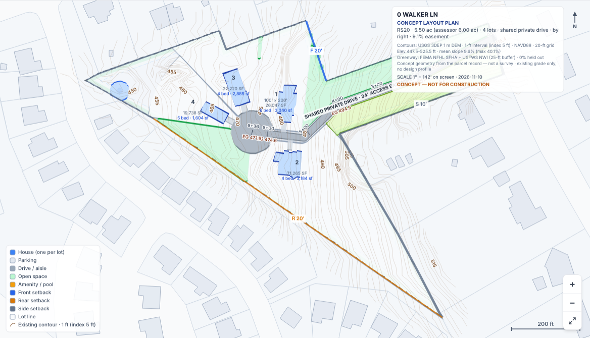 0 Walker Ln: four lots round a turnaround | 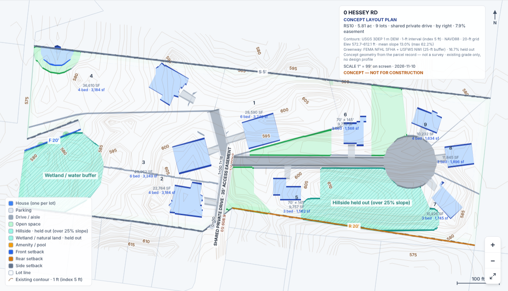 0 Hessey Rd: nine lots, two under the minimum, four oversized |
| 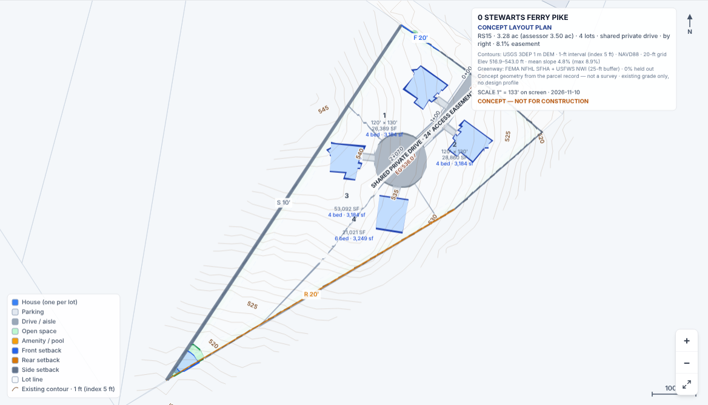 0 Stewarts Ferry Pike: a full turnaround on a 207-ft drive | 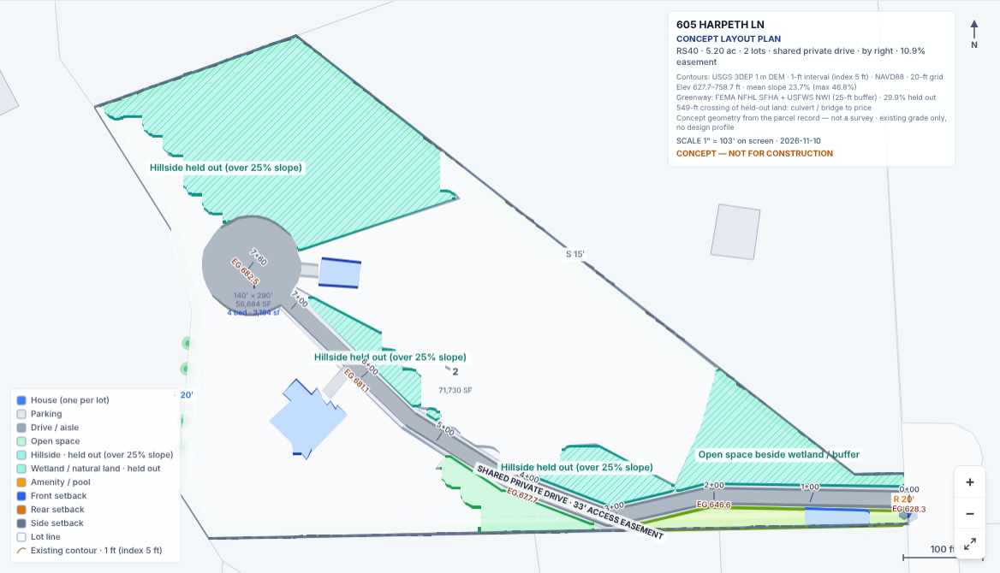 605 Harpeth Ln: a second lot bought with 549 ft of lane across held hillside |

Lotting the remainder, and the T street back:

| | |
|---|---|
| 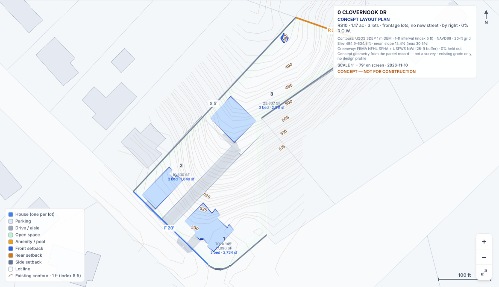 0 Clovernook Dr: two front lots and a flag | 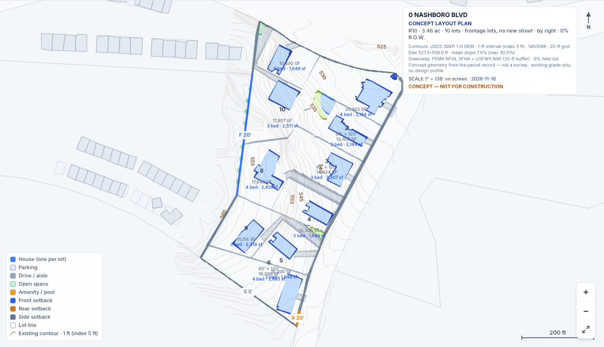 0 Nashboro Blvd: ten lots, three of them flag lots |
| 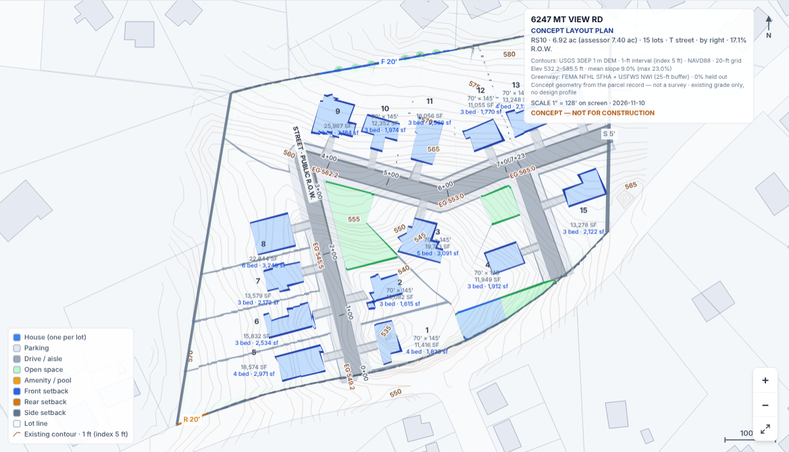 6247 Mt View Rd: the T street returns | 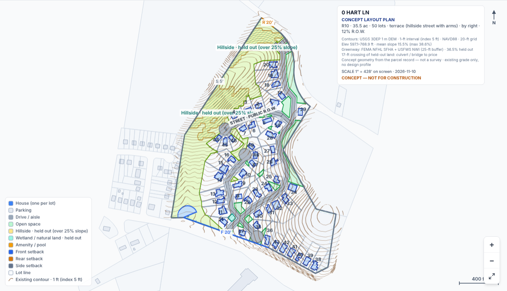 0 Hart Ln: the passing terrace plan is the default |

Withdrawn street plans and what replaced them:

| | |
|---|---|
| 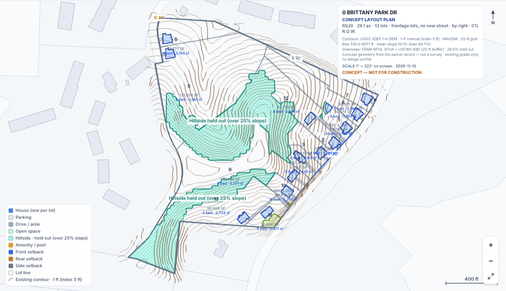 0 Brittany Park Dr: 13 frontage lots and five remainders on 29 ac | 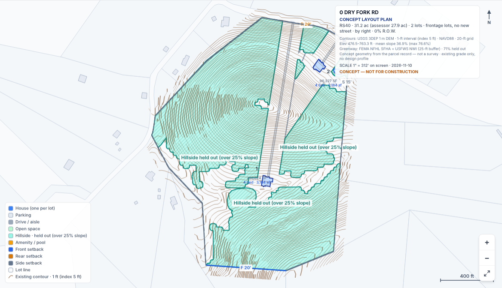 0 Dry Fork Rd: the loop is gone; one of the two houses is mid-mountain |
| 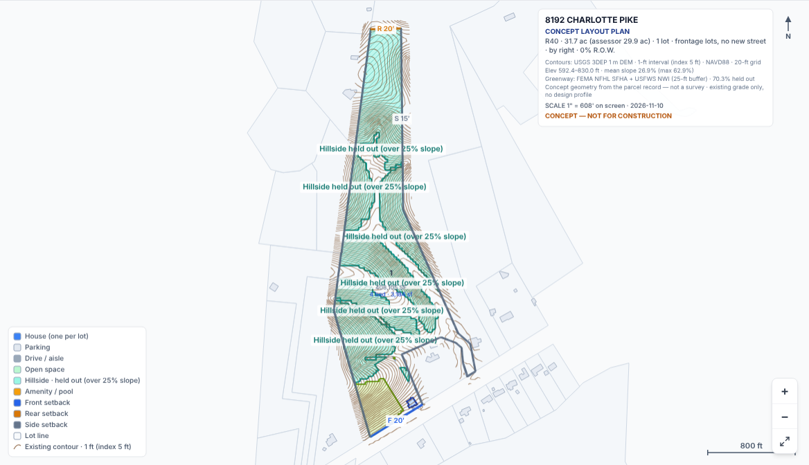 8192 Charlotte Pike: one house at the road, no error | 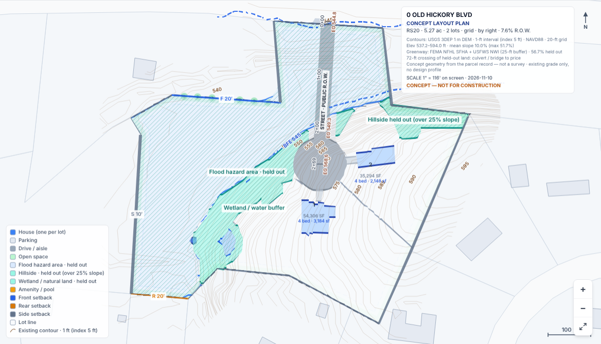 0 Old Hickory Blvd RS20: a public street across the flood hold for two houses |

The chip after the app fix:

| | |
|---|---|
| 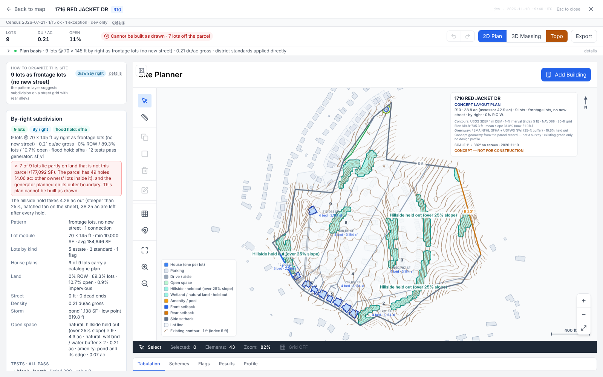 1716 Red Jacket Dr: "Cannot be built as drawn · 7 lots off the parcel" | 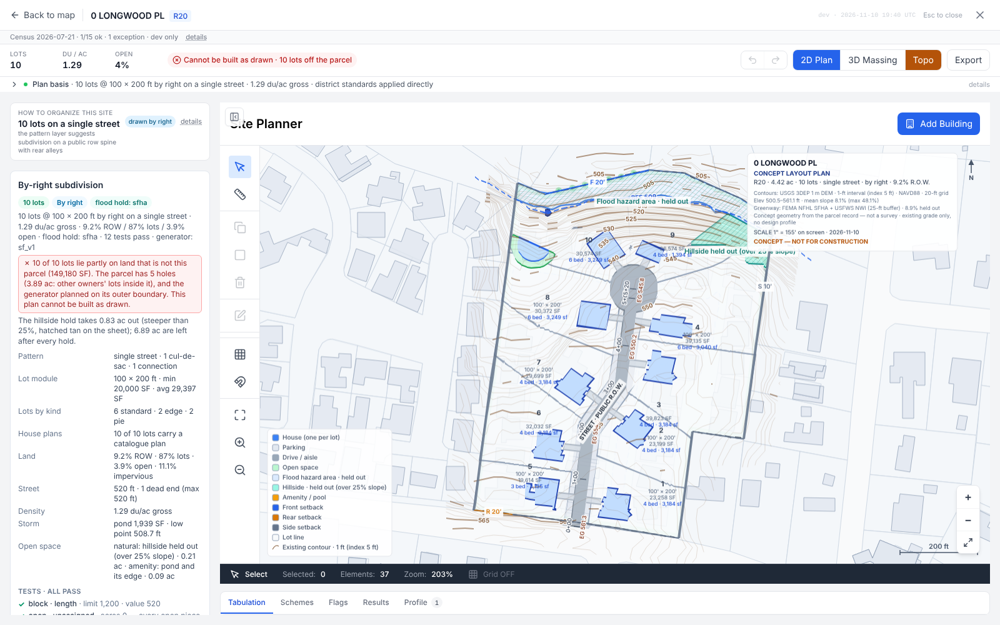 0 Longwood Pl: all ten lots on other owners' land |

## What changed in the app

- **A drive is compared by what it builds.** The engine reports a shared
  drive as 0 ft of street with its length in `drive_ft`. The same-lots rule
  read that as "0 ft of new private drive against 520 ft" and put a 536-ft
  lane on the sheet in place of a 520-ft public cul-de-sac at the same ten
  lots (0 Longwood Pl). The app and the scorer now count both lengths. The
  g16 run scores the same under the changed scorer.
- **Lane width is measured, not averaged.** "A 44-ft lane in a 56-ft access
  easement" on a 207-ft drive was area over length with the turnaround in
  it. Measured across the centreline it is 16 ft in 24, on every drive in
  the run.
- **The chip follows the panel.** Where lots sit on land inside the outline
  that is not the parcel, the header read "All 13 checks pass" above a
  panel saying the plan cannot be built. It now reads "Cannot be built as
  drawn · N lots off the parcel".

## For the owner

- The engine holds a shared private drive to 750 ft and 10 lots, both marked
  "to confirm". Three of the five fixes in this run are lanes of 1,637 to
  2,810 ft that fail the 750 and are counted as passing because the test is
  a flag. The Metro figures settle whether those are real.
- 0 Longwood Pl and 0 Abbott Martin Rd are co-op common areas: keep them in
  the cohort as refusals, or drop them.
- Still open from the last run: whether to sheet a buildable best over a
  failing default with more lots. On Hart Ln the engine has now made that
  choice itself.

## Files

- `ENGINE_HANDOFF.md`: the handoff for the engine side.
- `ranking.json`: every parcel with its previous and current likelihood.
- `scripts/engine-cohort/runs/2026-11-10_g17.json`: the scoreboard.
